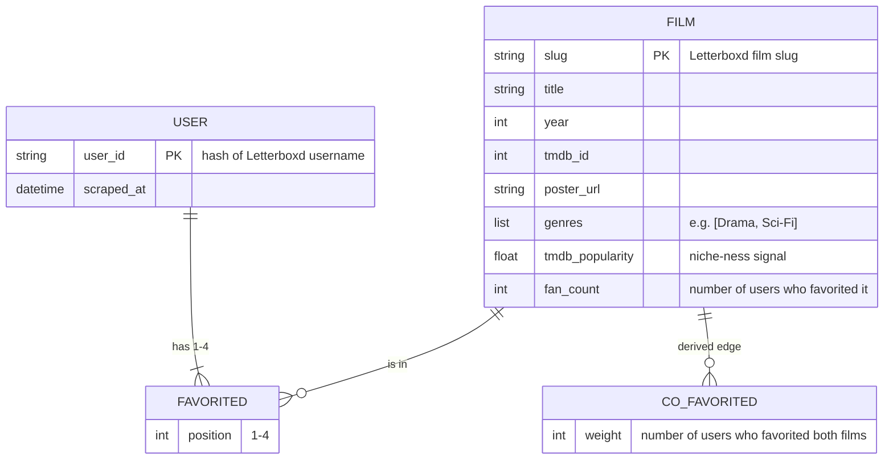
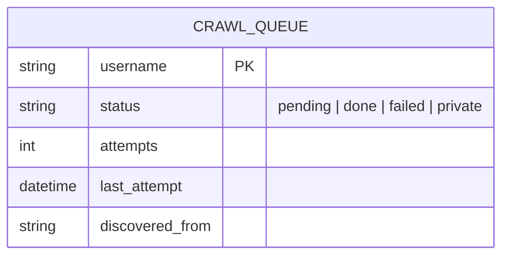
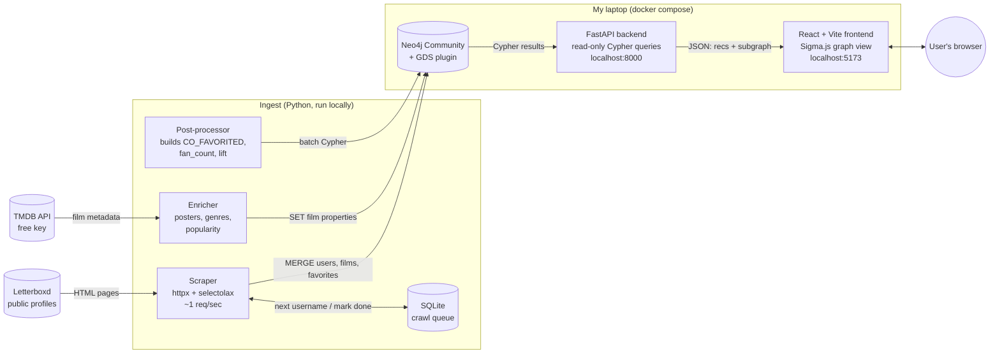

# Project Initial Design — "Four Degrees"

## 1. Summary

**A movie recommender built on one signal: other people's top 4.**

Every Letterboxd profile has four favorite films. Those four films often have
nothing in common except that one person loves all of them. This project
collects thousands of those top-4 lists, stores them in a graph database, and
uses the connections to recommend movies you probably haven't heard of.

Most recommenders say "you liked a sci-fi movie, here's another sci-fi movie."
This one says "someone who loves the same movie you love also loves *this*,"
even when the two films share no genre, decade, director, or country.

```
   YOU                    OTHER PEOPLE                     RECOMMENDATION
                     ┌──── @user_a ──── Paddington 2
 Stalker ────────────┤                                 →  "Stalker fans also
 (your favorite)     ├──── @user_b ──── Paddington 2       love Paddington 2"
                     └──── @user_c ──── Jeanne Dielman     (2 people, 0 shared genres)
```

### Goals
- **Recommend niche, surprising films.** Favor less popular films and films
  that are *not* similar to your input, instead of the same blockbusters every
  recommender pushes.
- **Explain every recommendation.** Show the path: *your film → N people who
  also love it → recommended film.*
- **Make the graph explorable.** An interactive visualization of films and the
  people that connect them is the main interface.
- **Cost $0.** Use only free tiers and open-source tools.

### Features
| MVP | Stretch |
| :--- | :--- |
| Scraper that collects top-4 favorites from Letterboxd profiles | Enter your Letterboxd username to import your top 4 automatically |
| Neo4j graph of Users → Films | "Adventurousness" slider: 1-hop (safe) vs. 2–3-hop (weird) recommendations |
| Pick 1–4 seed films, get ranked recommendations | "Surprise score": how few genres the recommendation shares with your seeds |
| "Niche dial" that penalizes popular films | Whole-graph "galaxy map" of every film with a precomputed layout |
| Interactive graph view of the seed films' neighborhood | Community detection (Louvain) to find "taste clusters" |
| Path explanation for each recommendation | |
| Posters and metadata from TMDB | |

Everything runs locally. The final deliverable is a recorded demo, not a
deployed site.

---

## 2. Data model (ERD)

### Graph model (Neo4j)



In Cypher terms, there are only two node types and two relationship types:

```
(:User)-[:FAVORITED {position}]->(:Film)       // raw data, from the scraper
(:Film)-[:CO_FAVORITED {weight}]-(:Film)       // derived, rebuilt from FAVORITED
```

**How you get from one film to another:** go from a film *back* along
`FAVORITED` to a user, then *forward* along another `FAVORITED` to a different
film. Each user is a hub connecting their (up to) four films:

```
Example data: three users' top 4s

  user_a: Stalker, Paddington 2, Jeanne Dielman, Heat
  user_b: Stalker, Paddington 2, Mulholland Dr., Ratatouille
  user_c: Heat, Ratatouille, Paddington 2, Alien

How it's stored: each ● is one FAVORITED edge (user → film).
Every film and every user is stored exactly once.

                   user_a   user_b   user_c
  Stalker            ●        ●
  Paddington 2       ●        ●        ●
  Jeanne Dielman     ●
  Heat               ●                 ●
  Mulholland Dr.              ●
  Ratatouille                 ●        ●
  Alien                                ●

Film → film = go across a row to a ● (a user), then down that column
to another ● (another film). Starting from Stalker:

                    ┌──► Paddington 2
       ┌── user_a ──┼──► Jeanne Dielman
       │            └──► Heat
  Stalker
       │            ┌──► Paddington 2
       └── user_b ──┼──► Mulholland Dr.
                    └──► Ratatouille

Path from Stalker to Paddington 2:
  Stalker ◄─FAVORITED─ user_a ─FAVORITED─► Paddington 2
  Stalker ◄─FAVORITED─ user_b ─FAVORITED─► Paddington 2
  → 2 people connect them, so CO_FAVORITED(Stalker, Paddington 2).weight = 2
```

- **User → Film (`FAVORITED`)** is the source of truth. Re-scraping a user
  replaces their four edges, so loading is idempotent and nothing gets
  double counted.
- **`CO_FAVORITED`** is a precomputed shortcut for the two-hop
  Film → User → Film path, with `weight` = how many users make that path. Each
  user with 4 favorites creates 6 film pairs. One Cypher query rebuilds it
  from `FAVORITED` at any time. It makes multi-hop queries and the
  visualization fast.
- **Genres** come from TMDB and are stored as a list on the film.
  Recommendations don't use them. They *measure* how surprising a
  recommendation is, e.g. "shares 0 genres with your seeds."
- **Usernames are hashed.** The app shows "a person who loves X," never the
  Letterboxd handle.

### Crawl state (SQLite, scraper side only)



This keeps the scraper resumable and stops it from re-crawling profiles. It
stays out of Neo4j because it's operational data, not graph data.

### Rough size (and why it fits the free tier)
| | Estimate at 25k users |
| :--- | :--- |
| User nodes | 25,000 |
| Film nodes | ~20,000 |
| `FAVORITED` edges | ~100,000 |
| `CO_FAVORITED` edges | ≤150,000 |

This runs on Neo4j Community in Docker on my laptop, which has no node or edge
limits, so the only constraint is how long the crawl takes. At ~1 request/sec,
25k profiles is about 7 hours of background crawling.

---

## 3. System design



### Components
| Component | Technology | Why | Cost |
| :--- | :--- | :--- | :--- |
| Scraper | Python, `httpx`, `selectolax`/BeautifulSoup | Letterboxd's API is invite-only, so profile HTML is the only source | Free |
| User discovery | Snowball crawl: popular members page → their followers/following | Builds a connected graph instead of random isolated users | Free |
| Enrichment | TMDB API (Letterboxd film pages include the TMDB id) | Posters, genres, directors, popularity | Free with API key |
| Graph DB | **Neo4j Community** (Cypher) in Docker, with the free Graph Data Science (GDS) plugin | Native graph traversal, good tooling (Neo4j Browser), the most widely used graph DB. Local means no size caps or idle pauses | Free |
| Backend | **FastAPI** + official `neo4j` Python driver | Same language as the scraper, generates API docs automatically | Free (runs locally) |
| Frontend | **React + Vite** with **Sigma.js + graphology** | Sigma renders large graphs with WebGL. graphology includes ForceAtlas2 layout and Louvain | Free (Vite dev server) |
| Orchestration | **Docker Compose** | One `docker compose up` starts Neo4j (and optionally the API), so the demo is easy to start for the video | Free |

**Local only.** The deliverable is a demo video recorded on my machine, so
there's no hosting, no public URL, and no cloud accounts besides a TMDB API key.

**Alternatives I considered:** Postgres with an edges table (works, but
multi-hop queries are clumsy, and the graph is the point of the project);
Memgraph (Cypher-compatible, but a smaller ecosystem); Cytoscape.js or
react-force-graph for visualization (simpler, but slow beyond a few thousand
nodes).

### Recommendation algorithm (v1 → v3)
1. **Taste-overlap co-occurrence (v1).** For seed films *S*, find every user
   who favorited any film in *S* and count how many of the seeds they share
   (`overlap`). Each of their other favorites earns `overlap²` points. One
   person who shares *two* of your seeds counts for more than two people who
   each share one. This only works because User nodes keep each person's
   top 4 together. A Film–Film-only graph would lose it.
   ```cypher
   MATCH (seed:Film)<-[:FAVORITED]-(u:User)
   WHERE seed.slug IN $seeds
   WITH u, count(seed) AS overlap
   MATCH (u)-[:FAVORITED]->(rec:Film)
   WHERE NOT rec.slug IN $seeds
   RETURN rec, sum(overlap * overlap) AS score, count(u) AS shared_fans
   ORDER BY score DESC LIMIT 20
   ```
2. **Niche adjustment (v2).** Raw counts always surface *The Godfather*,
   *Parasite*, etc., because everyone favorites them. Divide by popularity:
   `final = score / fan_count^α`, where α (0–1) is the "niche dial."
   Lift or PMI work the same way: how much *more* likely this film is among
   fans of your seeds than among everyone.
3. **Multi-hop / serendipity (v3).** Personalized PageRank or random walks with
   restart from the seed films over `CO_FAVORITED`. Going 2–3 hops out gives
   stranger results. Neo4j GDS (free plugin on Community) has personalized
   PageRank built in.

Every recommendation returns the **path(s)** that produced it, so the UI can
draw *seed → fans → rec* and explain why it was chosen.

### Security & ethics
Because everything runs on localhost, security is mostly good hygiene, not
defending a public service.
- **Secrets:** DB credentials and the TMDB key live in `.env` (gitignored) and
  only on the backend. The browser never talks to Neo4j directly. Neo4j ports
  are bound to `127.0.0.1` only.
- **Read-only API:** the backend opens sessions in `READ` access mode and only
  runs fixed, **parameterized** Cypher (no string concatenation, so no Cypher
  injection). Only the ingest scripts write.
- **Input validation:** Pydantic validates inputs (max 4 seeds, bounded hop
  count and result limit) so one request can't start a huge traversal.
- **Privacy:** store a hash of each username and never show handles in the UI.
  Collect only public favorites.
- **Polite scraping:** honor `robots.txt`, throttle to ~1 request/sec, cache
  pages so nothing is fetched twice, and keep the dataset small and
  non-commercial. Letterboxd's terms restrict automated collection, so this is
  scoped as a small academic project and the raw data is not redistributed.
- **No user accounts** in the MVP, so there are no passwords to protect.

---

## 4. UX sketch

```
┌───────────────────────────────────────────────────────────────────────┐
│  FOURFOLD          [ Import from Letterboxd: ________ ]  [Go]         │
├───────────────────────────────────────────────────────────────────────┤
│  Your four:  [Stalker ×] [In the Mood for Love ×] [+ add] [+ add]     │
│  Niche dial:  popular ●━━━━━━━○━━━ obscure                            │
│  Adventure:   1 hop  ●━━○━━━ 3 hops                                   │
├──────────────────────────────────────┬────────────────────────────────┤
│                                      │  RECOMMENDATIONS               │
│        (interactive graph)           │  1. [poster] Jeanne Dielman    │
│                                      │     7 people who love Stalker  │
│     ○ fan       ○ fan                │     also love this · 0 shared  │
│       \        /                     │     genres  [show path]        │
│   [Stalker]──○──[Jeanne Dielman]     │  2. [poster] Paddington 2      │
│       /        \                     │     ...                        │
│     ○ fan     [Paddington 2]         │  3. ...                        │
│                                      │                                │
│  click a film → re-center graph      │                                │
└──────────────────────────────────────┴────────────────────────────────┘
```

- Film nodes show posters. Fan nodes are small anonymous dots.
- Clicking a recommendation highlights its path(s) in the graph.
- Clicking any film node re-centers the graph on it for open-ended exploration.

---

## 5. Daily goals

*Target: MVP done before my presentation on **Mon Dec 7**. Last day of class
is Dec 10. Thanksgiving break is Nov 25–28.*

| Date | Goal |
| :--- | :--- |
| Tue Nov 17 | Repo set up, initial design doc |
| Wed Nov 18 | Inspect Letterboxd profile HTML. Scrape one profile's top 4 with Python. Check `robots.txt` and rate limits |
| Thu Nov 19 | `docker-compose.yml` with Neo4j Community + GDS. Constraints/indexes. Write `MERGE` loader and load 10 hand-picked users |
| Fri Nov 20 | Build SQLite crawl queue + snowball user discovery. Run first unattended crawl (~500 users) |
| Sat Nov 21 | Get a TMDB API key. Write the enricher (poster, year, genres, popularity). Start the long crawl (target 10–25k users) in the background |
| Mon Nov 23 | Write v1 co-occurrence Cypher query, check results by hand in Neo4j Browser |
| Tue Nov 24 | Post-processor: `fan_count`, `CO_FAVORITED` edges. v2 niche-adjusted scoring |
| Nov 25–28 | *Thanksgiving: light work.* Let the crawler finish. Re-run enricher + post-processor on the full dataset |
| Mon Nov 30 | FastAPI: `/films/search`, `/recommend`, `/graph/neighborhood`. Read-only sessions, parameterized queries |
| Tue Dec 1 | React + Vite scaffold. Film search/autocomplete and seed picker |
| Wed Dec 2 | Sigma.js graph view of the seeds' neighborhood, wired to the API |
| Thu Dec 3 | Recommendation list with posters + path highlighting in the graph. **MVP complete** |
| Fri Dec 4 | Niche dial + hop-count controls. Tune α on real data. Fix bugs |
| Sat Dec 5 | Record demo video. Prepare presentation slides |
| **Mon Dec 7** | **Present** |
| Tue Dec 8 | Stretch: Letterboxd username import or personalized PageRank (v3) |
| Wed Dec 9 | README with screenshots and setup instructions. Final cleanup |
| Thu Dec 10 | Final submission |

---

## 6. Open questions & risks
- **Scraping may get blocked** (Cloudflare / 403s). Fallbacks: slower rate,
  `curl_cffi` browser impersonation, or a smaller hand-curated user set.
- **Popularity bias.** Without the niche adjustment, recommendations will be
  dominated by the same ~50 canon films. This needs tuning.
- **Sparse niche films.** A film with 1 fan gives a noisy signal. Require a
  minimum `shared_fans ≥ 2`?
- **Crawl time.** A long crawl at a polite rate takes hours, so it needs to
  start early (by Nov 21) and be resumable if my laptop sleeps.
